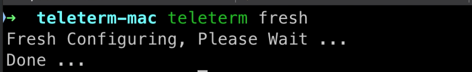
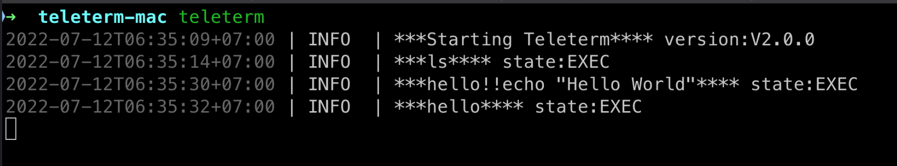
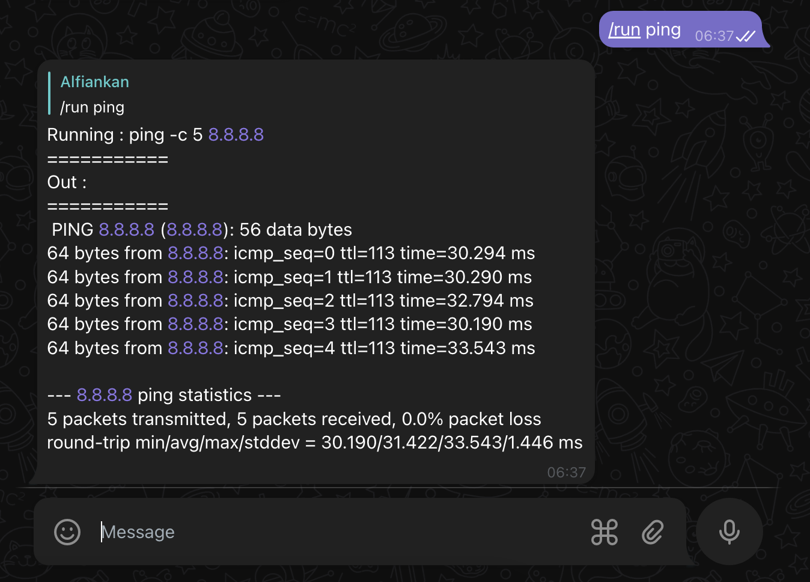
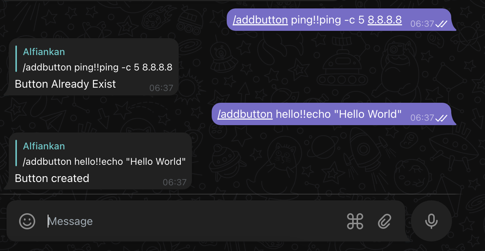
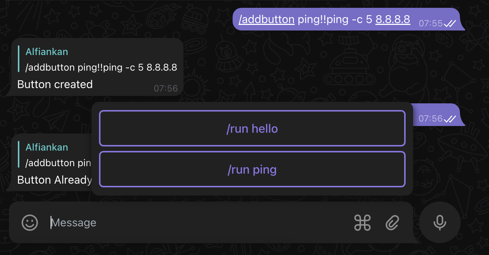
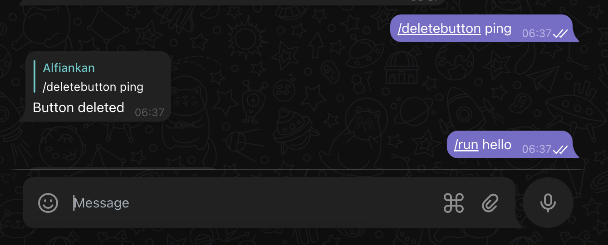
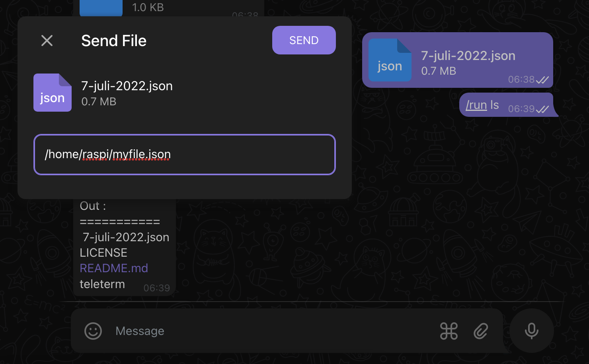
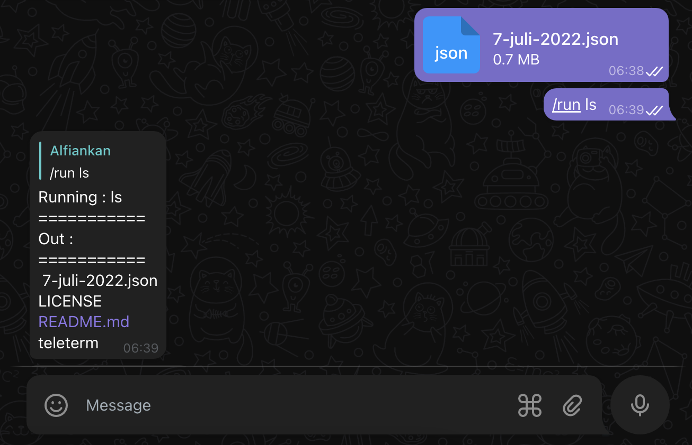
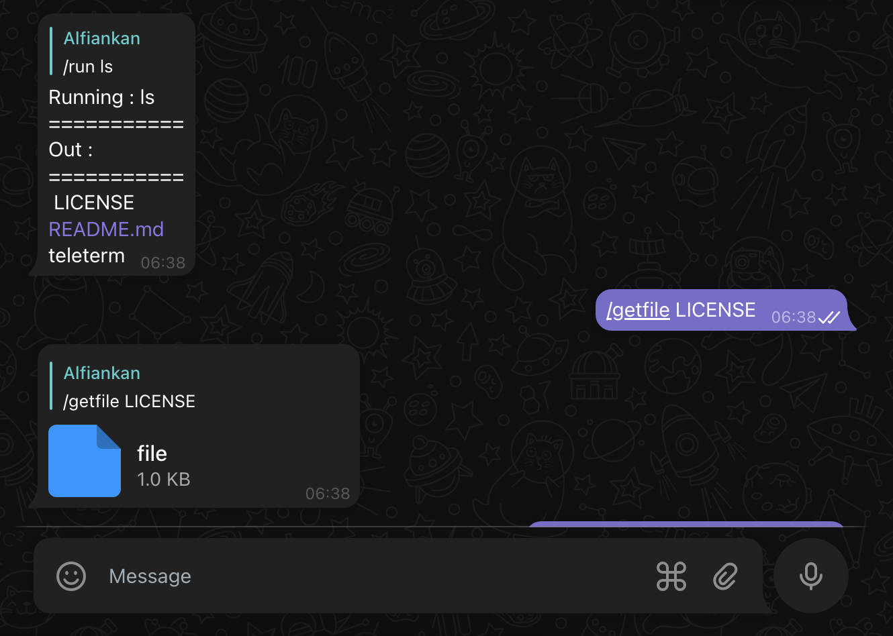

# Teleterm
Bot de Telegram para Ejecutar Comandos de Terminal 

## Resurrección
En esta era de agentes, crearemos un contenedor simple para un agente de IA de Telegram

[](https://codecov.io/gh/alfiankan/teleterm)
[](https://github.com/avelino/awesome-go)  
[](https://pkg.go.dev/github.com/alfiankan/teleterm/v2)
[](https://goreportcard.com/badge/github.com/alfiankan/teleterm)


## Casos de Uso
- Ejecutar comandos en dispositivos IoT a través de un bot de Telegram
- Transferir archivos a través de un bot de Telegram

## Cómo Instalar

1. Binario Precompilado
	Puedes descargar el binario precompilado según tu sistema operativo y arquitectura; los binarios disponibles están aquí:

	https://github.com/alfiankan/teleterm/releases/tag/v2.1.0
	
	Una vez descargado el binario, puedes moverlo a /usr/local/bin

2. Compilar desde el Código Fuente
	Si la arquitectura de tu sistema operativo no está en la lista de binarios precompilados, puedes compilar desde el código fuente.
	
	Requisitos:
	- Go ^1.18
	- gcc

	Cómo compilar:
	- Clona `git clone https://github.com/alfiankan/teleterm`
	- Compila `go build -o teleterm-bin ./cmd...`

## Cómo Ejecutar:
Requisitos:
- Tokens del bot de Telegram. Para obtenerlos, consulta la [Documentación de Telegram](https://core.telegram.org/bots#6-botfather)

1. Configuración Inicial

	Para configurar un teleterm desde cero, ejecuta:
	
	```bash
	teleterm fresh
	```
	
	

	teleterm creará una carpeta en tu directorio de inicio llamada `.teleterm` que contendrá:
	- config.yaml
		El archivo config.yaml guarda la configuración de teleterm:

		| Clave       |Valor          |
		| ------------- |-------------|
		| telegram_token | token de Telegram obtenido del BotFather |
		| shell_executor | `/bin/bash` o `/bin/sh`, etc. El valor predeterminado es `/bin/bash`|

		Ejemplo de config.yaml:
		```yaml
			teleterm:
  				telegram_token: "my_tele_token"
  				shell_executor: "/bin/bash"
		```

2. Ejecutar teleterm

	Para ejecutar teleterm, simplemente ejecuta `teleterm` y se mostrará la información de registro.

	


## Comandos Disponibles del Bot
| Comando       |Descripción          |Ejemplo          |
| ------------- |:-------------|:-------------|
|/refresh |Actualiza el sistema del bot | /refresh |
| /run `<command>`| ejecuta un comando | /run ping -c 5 8.8.8.8 |
| /getfile `<filepath>`| transfiere/descarga un archivo desde el servidor del bot | /getfile /home/raspi/myfile.txt |
|/addbutton `<button_name>!!<command>`| agrega un atajo de botón | /addbutton ping!!ping -c 5 8.8.8.8 |
|/deletebutton `<button_name>`|elimina un atajo de botón | /deletebutton ping |


## Ejecutar Comandos
Para ejecutar comandos desde Telegram, simplemente envía un mensaje con el siguiente formato:
```bash
/run <command>
```
Por ejemplo:
```bash
/run ping -c 5 8.8.8.8
```
Respuesta del bot de Telegram:



## Agregar Atajo de Botón
Para ejecutar comandos desde un botón de Telegram, necesitas agregar un botón. Simplemente envía un mensaje con el siguiente formato:
```bash
/addbutton <button_name>!!<command>
```
Por ejemplo:
```bash
/addbutton ping!!ping -c 5 8.8.8.8
```
Respuesta del bot de Telegram:



Aparecerá un nuevo botón:



## Botón de Atajo
Para ejecutar un comando usando un atajo, simplemente haz clic en el botón de Telegram; el bot buscará el comando ejecutable en la base de datos.

## Eliminar Atajo de Botón
Para eliminar un atajo, simplemente envía un mensaje con el siguiente formato:
```bash
/deletebutton <button_name>
```
Por ejemplo:
```bash
/deletebutton ping
```
Respuesta del bot de Telegram:



Luego aparecerán los botones actualizados.

## Subir Archivos
Para subir un archivo, simplemente envía el documento en Telegram:



Por defecto, se subirá al directorio de trabajo actual si no agregas una ruta de destino en la mención del archivo.

Respuesta del bot de Telegram:



## Descargar Archivos
Para descargar el archivo, simplemente envía un mensaje con el siguiente formato:
```bash
/getfile <filepath>
```

Filepath es la ruta del archivo donde se está ejecutando teleterm.

Por ejemplo:
```bash
/getfile /home/raspi/hello.txt
```
Respuesta del bot de Telegram:


